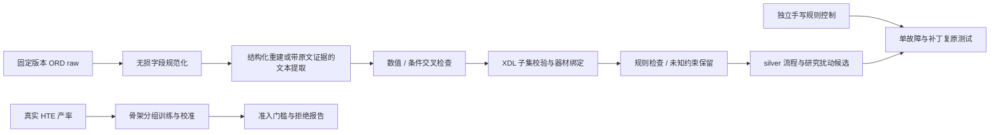

# 化学流程提取与单故障风险样例

当前是可复现的首批研究交付，完整规范仍有未验收项。**实际数量与缺口以 [统计报告](reports/stats.md)、[审计结果](reports/audit.json) 和 [任务状态](reports/task_status.json) 为准。** silver、手写控制、真实失败分别统计；不会把未核验数据自动标为 gold。

当前数据构造：140 组 raw/XDL 候选，237 条风险候选，20 类均 ≥10。新增 B2/B3/B5 在 `data/sop/`：B5 为 10 个原文配方片段的顺序扰动；B2/B3 共 24 条为带来源和明确假设的生成场景，独立父场景分别为 1、6 个。它们不冒充 24 次真实实验。统一分区入口见 [data/dataset.json](data/dataset.json)。

新增独立的 [人工审核网页工具](audit/README.md)：按逐条批改方式翻页，自动定位改动／待核对步骤，并排显示父子用量及风险证据，判定后进入下一条；完整资料按需展开。支持首次导入、打开已有 SQLite、撤销和时间戳导出。已导入 140 条 pos 与 237 条 neg，全部待人工审核。启动：`./audit/start_review.ps1`。审核数据库不与原始 JSON 同步，也不自动修改现有流水线的严格 gold 验收结果。

作者原生流程另有原配套平台的解析和编译结果，见 [原生平台报告](reports/native_platform.md)。通过条目在 `data/publications/platform_positives.jsonl`，未通过条目及原因也保留。作者成功分区与仅翻译分区分别统计，未授予完整 gold。

## 快速复现

Windows / PowerShell，Python 3.10：

```powershell
python -m venv .venv
.\.venv\Scripts\python.exe -m pip install -r requirements.lock.txt
$env:PYTHONPATH = "$PWD\src"
.\.venv\Scripts\python.exe -m protocol_risk build --limit 140 --per-risk 12
.\.venv\Scripts\python.exe -m protocol_risk build-sop
.\.venv\Scripts\python.exe -m protocol_risk audit
.\.venv\Scripts\python.exe -m protocol_risk report
.\.venv\Scripts\python.exe -m pytest -q
```

已有原始文件、规范化 Parquet 和提取快照时，上述重建不访问网络，不调用 API。完整封装：

```powershell
.\scripts\reproduce.ps1
# 从锁定来源恢复 raw，并重新训练研究基线：
.\scripts\reproduce.ps1 -Fetch -Train
# 明确需要重新调用 API 时：
.\scripts\reproduce.ps1 -RefreshExtraction
```

`.env` 必须由用户提供 `api_key`、`base_url`、`model`。参考 `.env.example`。`api-check` 会发出真实密钥请求和随机无效密钥对照，不输出密钥。接口可以验证连通性、鉴权和 JSON 返回，不能独立证明代理背后的模型身份。当前兼容端点无需额外添加 `/v1`；以用户提供的 base_url 为准。

## 工具命令

```powershell
.\.venv\Scripts\python.exe -m protocol_risk api-check
.\.venv\Scripts\python.exe -m protocol_risk fetch
.\.venv\Scripts\python.exe -m protocol_risk ingest
.\.venv\Scripts\python.exe -m protocol_risk extract --limit 200 --workers 4
.\.venv\Scripts\python.exe -m protocol_risk extract-one my_procedure.txt --output my_extraction.json
.\.venv\Scripts\python.exe -m protocol_risk train
.\.venv\Scripts\python.exe -m protocol_risk props-sync
.\.venv\Scripts\python.exe -m protocol_risk collect-chemputer
.\.venv\Scripts\python.exe -m protocol_risk prepare-publications
.\.venv\Scripts\python.exe -m protocol_risk audit-publications
.\.venv\Scripts\python.exe -m protocol_risk scan-amounts
.\.venv\Scripts\python.exe -m protocol_risk hte-contrasts
.\.venv\Scripts\python.exe -m protocol_risk audit-contrasts
.\.venv\Scripts\python.exe -m protocol_risk verify-rebuild
.\.venv\Scripts\python.exe -m protocol_risk build-native-negatives
.\.venv\Scripts\python.exe -m protocol_risk audit-native-negatives
.\.venv\Scripts\python.exe -m protocol_risk build-sop
.\.venv\Scripts\python.exe -m protocol_risk audit-sop
# 可选原生平台依赖；附带的 Windows/Python 3.10 wheel 可离线安装：
.\.venv\Scripts\python.exe -m pip install --no-index -r requirements-platform.lock.txt
.\.venv\Scripts\python.exe -m protocol_risk validate-native-platform
.\.venv\Scripts\python.exe -m protocol_risk audit-native-platform
```

`extract-one` 支持 UTF-8 纯文本或包含 procedure、components 及来源的规范化 JSON。纯文本输出为未复核 IR；没有独立结构化字段时不自动晋级。API 提取最多修复 3 轮；实体、证据子串和显式数值校验失败会保留错误记录。已有按输入哈希缓存的请求会复用，清除缓存或更换模型可能改变结果。

## 文件布局

```text
jev_protocol_risk_spec.md          原始需求（保留）
libraries/
  hardware.yaml                   器材库：参数、材质、来源与人工验证状态
  primitives.yaml                 12 个原子操作的唯一权威定义
  macros.yaml                     宏的分解条件，不补造未知参数
  risks.yaml                      20 个风险子类
  properties.yaml                 有来源的物性、兼容性和敏感性条件
  reactivity.yaml                 有来源的结构分组和配对风险，标明推断范围
  studies.yaml                    实测对照研究的来源及重复导入排除记录
  sop_recipes.yaml                10 个原文配方、B2/B3 实例规则与明确假设
  rules_order.yaml                加料顺序规则
  rules_required_steps.yaml       必要步骤规则及启用状态
schemas/xdl2_subset.xsd            明确标注的 XDL 2 子集
src/protocol_risk/                 抓取、提取、校验、导出、扰动、审计、HTE 基线
data/
  sources.lock.json               固定上游版本、URL、SHA256
  upstream/                       ORD 原始文件和许可
  raw/reactions.parquet           全部真实 raw 与规范化字段，可流式读取
  raw/protocols/                  选中流程的独立完整 raw 文件
  raw/selected.jsonl              选中流程清单
  intermediate/extractions/      可离线复用的文本提取快照
  positives.jsonl                 来源可信但尚待完整复核的流程
  negatives.jsonl                 真实父流程派生的研究候选，非 gold 训练集
  native_negatives.jsonl          作者原生 XDL 的单语句缺失样例，附图状态与物料依赖证据
  dataset.json                   全部来源分区、格式、逐风险数量和缺口的统一入口
  sop_sources.lock.json          SOP 来源文件与提取文本的 SHA256
  platform_sources.lock.json     论文配套编译器源码的成员 SHA256 与 ZIP CRC32
  sop/                           原文 SOP 片段和生成场景的父流程、错误变体
  xdl/positive/                  独立 XDL 文件
  xdl/negative/<risk>/            候选错误流程 XDL
  xdl/native_negative/<risk>/     作者原生格式错误流程 XDL
  xdl/sop_positive/              SOP 父流程片段 XDL
  xdl/sop_negative/<risk>/       SOP 错误变体 XDL
  controls/                      手写控制父流程、负例与各类 XDL
  hte/observations.parquet        HTE 实测成功 / 低产率记录
  hte/contrasts.jsonl             其余记录条件相同的单因素实测对照，含全部重复实验
  publications/                  作者原始 XDL 索引、成员校验和、机械修复及待确认项
  publications/platform_positives.jsonl  原图编译通过的独立参考分区
  compiled/publication/          原配套编译器生成的 .xdlexe
  xdl/publication/               通过静态 XML 与引用检查的作者程序副本，独立于 ORD
reports/                          数量、审计、人工复核队列、模型准入报告和图表
models/hte_baseline.joblib         本地训练的研究基线；未获 judge 准入
tests/                            规则边界、单故障、补丁复原、来源与防泄漏检查
```

## 流程与标签



hard 是对有依据约束的违反；soft 的实验结果和失败概率保持 null。HTE 的 real 表示实测低产率，不能据此自行归因到某个 C 子类。父子共享 split，骨架组不会跨 train/val/test；假负样本过滤检查全部固定来源中已观察到的成功条件。

本项目子集校验不等于官方平台编译或实机运行。器材来源核对不等于规范要求的人工 verified。细节见 [数据卡](docs/DATA_CARD.md)、[人工核对入口](docs/REVIEW.md)、[实施计划](docs/PLAN.md)、[Judge 报告](reports/judge_report.md)。

`validate-native-platform` 使用论文归档的 XDL/ChemputerXDL 源码及独立适配层，开展原图编译并启用内置检查。适配层记录 XML 包装、带单位的属性别名，以及未命名 Async 的稳定缺省 ID；显式等待关系不变。所有真实设备 I/O 被禁用，耗时估算仅允许模拟控制器。第三方源码及许可证保存在 `data/upstream/platform_2022/`；其中 ChemputerXDL 的许可证为 AGPLv3，XDL 核心为 MIT。该检查不改变主数据的 gold 状态。

用量核对会从试剂别名旁的原文数量独立解析质量、体积和物质的量，必要时用结构计算分子量进行 ±10% 比较；不跨试剂借用数字，也不把 mol% 或浓度当成绝对用量。别名与化学实体的对应仍需审核。原文与结构化用量冲突的流程会被排除。

当前优先补齐风险数据，人工审核暂缓。器材参数只有在有出处并已核对后才用于临时研究约束，标记 `source_reviewed_provisional`；不由此授予人工 verified 或 gold。A2 可注入超出明确设备上限的控制指令，记录为控制器设定值，不把原文液体温度强行换算为热板温度。

`native_negatives.jsonl` 直接修改作者原生 XDL，每条删除一处必需的物料转移语句。硬件图给出目标容器初始为空，后续仍要求蒸发，且不存在其他进料语句。保留作者成功分区、父文件 SHA256、图文件 SHA256、步骤 XPath 和精确补丁；不把删除普通过滤步骤一概当作错误。

作者数据包的来源、分区、修复和审计见 [原始 XDL 参考语料报告](reports/publication_corpus.md)。采集器通过 HTTP Range 获取 ZIP 目录和指定成员，原始文件保留不变；不下载视频和整份 NMR 存档，也不连接图中列出的设备地址。

`hte-contrasts` 从同一研究中寻找单一溶剂身份、试剂身份、用量、温度或时间不同的实验，其余已记录条件与分析方法必须相同。成功设置的全部重复实验须 >30%，失败设置的全部重复实验须 <5%；中间产率和重复分歧不会被隐藏。对照用于补充实验依据，不能证明未记录条件相同，也不自动授予某个 C 子类 judge 资格。`audit-contrasts` 重新读取上游原始记录并检查完整重复实验集合。

`verify-rebuild` 禁用 HTTP 后重新生成已有的流程、单故障样例、作者 XDL 副本和实测对照，比较文件集合与每个文件的 SHA256。结果见 `reports/reproducibility.json`；新增、缺失和内容变化均会使验证失败。

## 可复用来源

- [ORD 数据](https://github.com/open-reaction-database/ord-data) 与 [ORD schema](https://github.com/open-reaction-database/ord-schema)：解析、来源和结构化字段。
- [XDL 2 标准](https://croningroup.gitlab.io/chemputer/xdl/standard/index.html)：步骤与属性映射。
- [paragraph2actions](https://github.com/rxn4chemistry/paragraph2actions)：动作词表参考；本交付没有伪称已安装或运行其独立预训练模型。
- [NIOSH](https://www.cdc.gov/niosh/npg/)、[CAMEO](https://cameochemicals.noaa.gov/) 与厂商资料：库中每个事实记录具体来源。

ORD 派生数据按上游 CC BY-SA 4.0 保留署名与许可。手写规则控制为 CC0。第三方资料和商标属于各自权利人。
# 2030-Project

