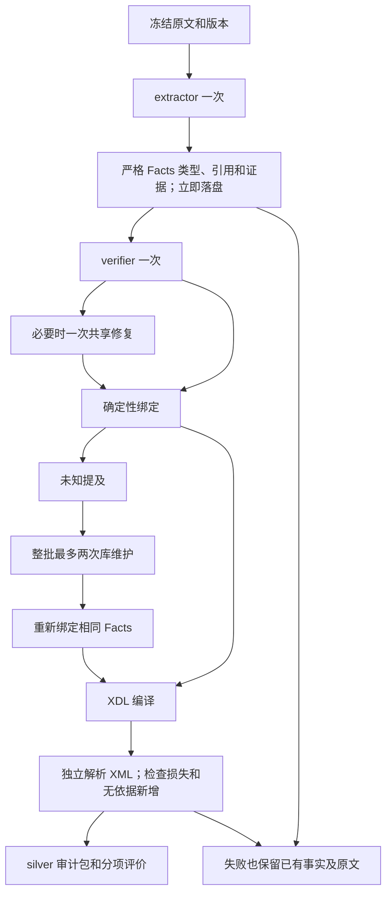

# Facts 架构

公共接口为 convert(ConversionSpec(...), runtime=Runtime(records=...))，命令行为 mosaic extract。领域合同 experimental.facts/1 不限制化学操作枚举；生物、材料的新语义可以进入同一事实合同和库演化流程。

facts.py 用 Pydantic 严格区分 quantity、text、reference、missing。打印数值以字符串保存，比较使用 Decimal。事实具有 subject、event、attribute、scope、evidence。重复片段必须定位到具体出现位置；数量及对应单位必须出现在引用片段中。不存在的设备和引用不能由编译器修复。

fact_extraction.py 只发送纯文本、合同及核查所需事实。格式修复发生在事实首次接纳前；语义修复使用局部 JSON Patch，不能改动无关对象。二者共用一次预算。核查失败时，已通过结构检查的事实仍保存在程序回执和候选中，也能提供库观察。

fact_binding.py 只做登记表达的精确归一。fact_evolution.py 提出已有概念对照、反例与合同，通过 Registry.evolve 事务准入。类别、子型、别名及替换分别验证；实例额定值不能进入语义合同。库改变只触发重新绑定，不触发重新生成事实。

fact_xdl.py 编译常规元素／属性，将配置、证据及规范 ID 放在配套 JSON。已验证的热控和搅拌同步有原生降级；其他并发控制流明确失败。新操作的必需参数缺失时生成未赋值 Parameter，不生成执行器。

evaluation.py 独立读实际 XML；位置账本必须与物料、容器、属性、范围、值、动作、类型相符。额外添加的 Wait、温度、试剂或配置也会被拒绝。参考评分另外检查规范操作和子型 ID，避免原文动作提对、最终映射却选错。模型一致不能提供真值。

engine.py 固定源码／提示、输入、库、模型配置、依赖版本、评价文件和预算，逐来源运行、批末维护库后编译汇总。store.py 提供原子写入、不可变回执和哈希链；verification.py 做离线产物与编译保真核对。

未实施的部分：专家标注集、自动提示优化、专家经验检索、任意并发／循环的完整调度、新操作执行器。DSPy／GEPA、LangExtract 等暂作设计参考，未引入第二套运行时编排。工程转换率和科学准确率分别报告。
