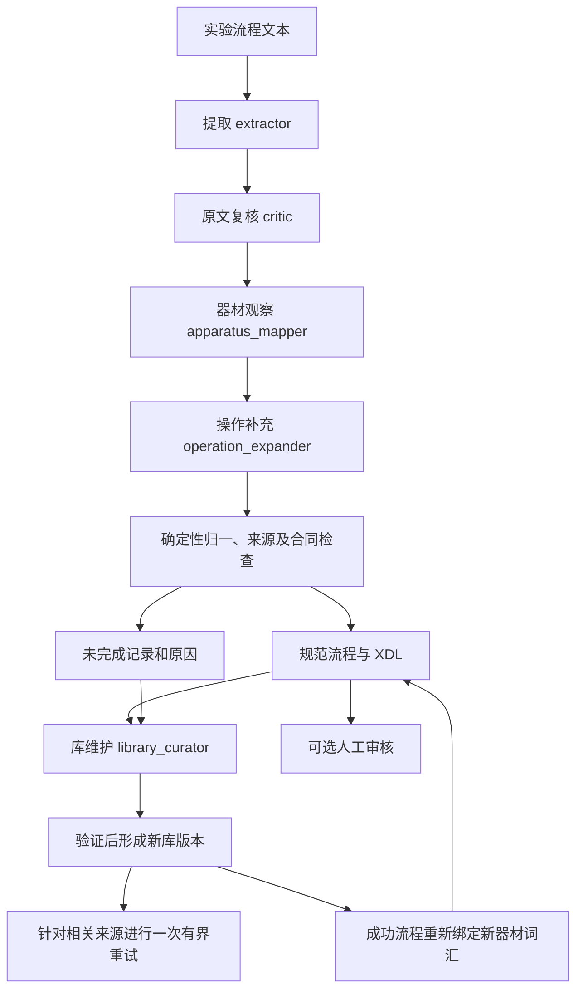

# 当前架构

公共入口是 `mosaic extract`，Python 入口是 `convert(ConversionSpec(...), runtime=Runtime(records=...))`。输入为显式提供的实验流程原文，输出为带证据的规范流程和 XDL。

提取失败时，扩展角色仍可从原文重新表达动作。覆盖检查使用启发式动作识别与模型复核；不能据此声称已经证明完整动作覆盖。

## 职责

- `engine.py`：并行处理独立来源、预算、冻结快照、库维护后的有限重试，以及离线重放。
- `chemistry.py`、`completion.py`：模型建议和逐字段来源验证；模型不生成或执行 Python 代码。
- `proposal_mappings.py`、`canonical.py`：登记表述先解析，再校验，最后保存统一规范名称。
- `registry.py`、`evolution.py`、`vocabulary.py`、`equipment_evolution.py`：版本化库与有证据的操作／器材变更准入；提案有一次验证反馈修复机会。
- `apparatus_mapping.py`：绑定原文器材，将明确来源与操作隐含需求分开，不赋予推测的额定参数。
- `protocol/`：文本用量、规范合同、器材归一和组合时序；`xdl_document.py` 单独生成普通 XDL，分析数据保留在 JSON。
- `store.py`：原子写入和哈希链；凭据不进入回执。
- `verification.py`：从冻结来源核对输出、证据、指纹、XML 再生成和旁文件。
- `audit/`：可选的人工结果检查，不参与模型推理或转换事实生成。

来源中的缺参保留状态；工具遗漏动作、产生无依据参数或非法合同则记录为未完成。物理安全、设备驱动和官方平台编译不由这套表示工具认证。

领域实现可通过 `Runtime(domain=...)` 注入。核心编排只要求提取、验证、库和统计接口；领域解析、物理语义及执行能力需要各领域独立实现。目前主要实现化学流程。

多角色分工参考了 [ACRA](https://github.com/croningp/acra) 的提取、消歧和复核设计；本项目独立维护来源证据、规范词汇和表示合同，没有复制其完整硬件执行系统。
