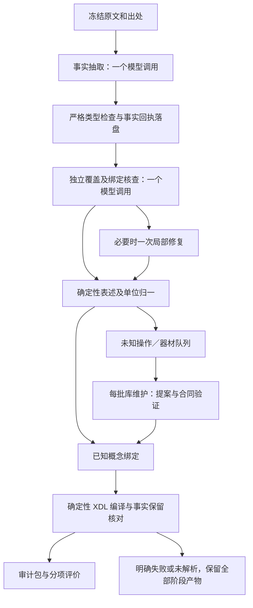

# MOSAIC：事实提取、评价与自动演化设计草案

日期：2026-10-30。状态：**待讨论，尚未实现**。本轮不修改冻结版本 `07e3259` 的运行时代码，不重新调用模型提取。组件调研见 [一手资料](research/EXTRACTION_COMPONENTS.md)。

## 目标与当前诊断

目标是让同一版本自动适应新 protocol：既保留基本事实，也能准入新操作／器材，最终生成常规 XDL 元素和属性语法的扩展文件。库扩展不等于提取质量达标；单元测试通过不等于真实文本抽取正确。

现有回执暴露了四个接口问题：数量对象在不同阶段重复包装；同一温度以数值和带单位字符串出现时被误判冲突；用步骤数组的精确顺序约束气氛等条件；提取中间结果可能在后续失败时不可复用。因此不应继续为每个样例增加兼容分支。先固定统一事实合同、参考答案和比较规则，再做一次整体验收。

## 1. 推荐架构



这里只让模型处理语义抽取、独立核查和确有需要的库建议。JSON 类型、单位换算、引用绑定、XDL 序列化、统计和状态管理交给程序。提取器不受当前操作枚举限制：遇到未知动作仍保存其原文提及与参数，随后交给库维护。

正常路径为两次模型调用；模型格式或事实遗漏共用一次局部修复预算，不是每种错误各重试一次。库维护每批最多两次调用（提案、必要时修复）。五条输入的建议 completion 上限为 `5 × 3 + 2 = 17`；HTTP 重连、能力探测与预算消耗分别记录。这是待确认的预算规则，不是已测得的速度。整批另设墙钟上限，不能靠延长运行与无界重试完成。

借鉴 LangExtract 的原文定位与 ACRA 的分层核查，保持 MOSAIC 现有持久化编排。复杂框架不是前置依赖。[LangExtract](https://github.com/google/langextract)、[ACRA 主流程](https://github.com/croningp/acra/blob/main/acra/main.py)

## 2. 统一的 Facts IR

Facts IR 是内部 JSON，不改变最终 XDL 语法。抽取、核查、归一、库演化和编译共享同一合同，禁止各角色自由定义另一套 quantity 容器。

| 对象 | 必须表达的信息 |
|---|---|
| 来源片段 | source_id、原文哈希、字符区间、逐字 quote；重复文字要定位到具体出现位置 |
| 物料／器材实体 | 稳定局部 ID、原文提及、别名证据、物料或器材角色；规范概念可暂未解析 |
| 事件 | 原文动作、参与实体、目标容器、源文证据；观察与物理动作分开 |
| 独立事实 | 所属实体／事件、属性、值类型、原始值及单位、状态、适用范围、证据 |
| 关系 | applies_to、located_in、precedes、during、same_interval、repeat 等；保留部分顺序 |
| 映射记录 | 原始事实 ID → 规范合同／参数 → 编译属性或合法外部配置位置 |

参数值用显式类型区分 `quantity / text / reference / missing`，而不是把所有内容塞进字符串 `amount`。例如：

```json
{
  "fact_id": "q1",
  "subject_id": "material_1",
  "event_id": "charge_1",
  "attribute": "dose",
  "value_type": "quantity",
  "quantity_kind": "mass",
  "value": "1.98",
  "unit": "mg",
  "status": "reported",
  "evidence_ids": ["span_1"]
}
```

`value` 的字符串形式保存打印精度，数值运算使用 Decimal 或同等精度的内部类型。`1.98 mg` 与 `1.5 mol%` 是同一加料事件的两个独立事实；`24.2 mg` 与 `0.2 mmol` 也不能互相覆盖。百分比／当量的参考基准未说明时，保留基准未知，不能猜定是哪一种底物。

数量归一必须先知道 quantity_kind 和归属：器材标称容积不同于投料体积、加热块温度不同于样品温度、相对离心力不同于质量。质量与物质的量不借助结构推算。室温保留定性状态，不填写 25°C。单位等价的数值与原始文本应建立转换关系，而不是互相覆盖或直接判冲突。

Pydantic 的显式判别类型和严格校验适合维护这个合同；Pint 适合维度换算，但不能自己判断物理量归属或 `g` 的语义。建议实现时先评价这两个依赖的价值，避免继续手写重复类型与单位适配。[Pydantic unions](https://docs.pydantic.dev/latest/concepts/unions/)、[strict mode](https://docs.pydantic.dev/latest/concepts/strict_mode/)、[Pint](https://pint.readthedocs.io/en/stable/getting/tutorial.html)

## 3. 核查与模型协作

独立核查器对照原文和 Facts IR，输出结构化差异：`missing_fact / unsupported_fact / wrong_binding / wrong_scope / wrong_relation / ambiguity`，每项附原文位置和相关事实 ID。它不直接重写全流程，也不把自己的判断升级为评测真值。

程序另建源文数字、单位和器材提及的候选清单，检查哪些片段尚未被事实覆盖，再交给核查器判断其归属，避免只核对生成器已经说出的内容。候选清单本身也会有误报，不能充当 gold。核查器不接收生成器的解释和自评分；“独立”指独立调用与核查职责，同一模型的错误仍可能相关，不能据双模型一致宣称正确。

局部修复只允许处理这些差异；保留已验证事实的 ID 与值。确需修改已有事实时，要给出冲突证据并重新验证。重排事件数组不应改变气氛等条件的实际作用区间。原文并列列举的加料物料，也不应被评测器凭空要求一个唯一先后次序。

错误先分类再路由：原文缺参 → 标记；模型格式／事实问题 → 共用的一次修复；新概念 → 库维护；已合法的模型对象被适配器改坏、编译器异常等程序缺陷 → 停止当前验收并保留回执，不继续耗费模型调用。传输失败按单独预算处理，不冒充语义失败。

框架选择：

- 服务端确实支持 JSON Schema 时启用结构约束，否则使用普通 JSON 加本地验证；不把 API 地址兼容视为能力证明。客户端安装 Outlines／llguidance 不能约束不受控制的远端采样。
- LangExtract 可作为事实抽取对照；首版不引入第二套完整编排。
- 先用精确词汇／来源条件检索有关合同和已验证示例，避免把整个历史库放进每次提示。检索示例不能把旧流程的数值带入新来源。
- DSPy／GEPA 只作为可选离线提示优化器，预算、评分器和参考答案冻结。优化结束导出固定提示，不在每条 protocol 内运行自我优化。

这些工具解决的是定位、结构或优化机制，均不提供本领域事实真值。技术边界与来源详见 [组件调研](research/EXTRACTION_COMPONENTS.md)。

## 4. 自动演化的范围

**规范库演化**：未知提及 → 对已有概念做比较 → 别名／参数变体／组合／新语义分类 → 合同提案 → 类型、来源、反例和正负见证验证 → 新库版本 → 对同一事实回执重新绑定。重新绑定不能再从原文重新生成一套事实，也不能新增额定参数。

优先使用参数表达差异。例如 StirAtTemperature 应先检查能否映射到混合操作及温度条件；microreactor 必须保留标准子型，且没有流动模式证据时不能推断连续流。条件替换只做候选关系，仍需检查具体容量、材料、温度、接口和模式。准入代表能表达，科学判断仍为 silver。

**经验／提示演化**：专家确认且保真检查通过的例子才能进入可检索经验库。提示优化只在开发集执行，候选版本通过冻结 dev 比较与回归后才能推广；不自动改变评分规则，不窥看 held-out 标注，不修改源代码。GEPA 可利用分项文字反馈优化提示，但效果需要本任务评价。[GEPA 论文](https://arxiv.org/abs/2507.19457)

自动演化应有三个可单独验收的场景：

1. 同义表述归入已有条目，新增规范 ID 数量应为零。
2. 真正新语义准入后，不改源码即可表达下一条不同来源的同类流程。
3. 信息不足或替换条件不满足时保留 unknown，不强制匹配；候选不冒充已验证条目。

## 5. 评价体系

### 5.1 独立参考答案

评价参照应是专家确认的事实清单和关系，不是一份唯一字符串形式的 XDL。助手／模型可以生成标注草案，但只有专家确认后才标成 gold。生成器与核查器彼此同意，不构成真值。

每个参考事实有 `required / optional / ambiguous`、信息类别、关键性和允许的等价表示。操作证据、物料、用量、条件、器材及关系分别评分。明确的原文缺参与模型遗漏必须区分：已报告的事实被写成 NOT_REPORTED 算遗漏；原文没有的条件被补数算无依据新增。

### 5.2 分项指标

| 维度 | 计量方式 | 防止的失败 |
|---|---|---|
| 事实完整性 | 相对参考的 precision、recall、F1；按流程报告 macro，再报告全体 micro | 空输出得高分；只看新增错误而不看遗漏 |
| 数量保真 | 数值、单位、打印精度、数量种类与作用范围分别核对 | 丢 mmol、覆盖质量、错处理比例／范围 |
| 事实绑定 | 数量→物料→事件→容器的完整绑定正确率 | 数字正确却配给另一种物料 |
| 操作与时序 | 语义事件及关键关系的 precision／recall，允许合法部分顺序 | 根据数组顺序误拒等价气氛条件；把并行条件串行化 |
| 器材 | 类别、子型、配置事实和条件替换状态分别计分 | 微反应器降为普通容器；型号膨胀；未知额定值被补全 |
| 缺参／定性 | 相对已标注槽位的状态混淆表，记录错误补数与已知误标未知 | 把数据缺参当提取失败；把遗漏藏进 unknown |
| 编译保真 | 每个已验证事实是否进入允许的输出位置；数量、引用及关系是否保持 | Facts IR 完整，但 XML 丢了洗脱比例或第二种用量 |
| 演化能力 | 别名复用正确率、新概念准入、拒绝错误合并、演化后的旧案例回归 | 单纯增加条目数量被当作演化成功 |
| 可用性与成本 | 原始输入的端到端通过率、错误分类、完成率、缓存命中、各角色调用、token、耗时 | 从分母删除失败记录；只报最好一次结果 |

TP 是**值、归属、范围和必要关系都正确**的参考事实匹配。错误绑定计入 FP 与 FN；同一输出不能重复匹配多个参考。对打印数值使用来源精度和可证明的单位换算，不能全局允许 10% 误差。可接受的语义同义由已审映射与专家标注决定，模型裁决的歧义单列，不悄悄当 TP。

参考答案比对借鉴事实 precision／recall 思路，但采用领域结构化匹配；不直接用通用文字相似度代替。代码、模型、人工评价各有职责，模型评审需与专家结果校准。[Ragas factual correctness](https://docs.ragas.io/en/latest/concepts/metrics/available_metrics/factual_correctness/)、[Anthropic evaluation guidance](https://www.anthropic.com/research/demystifying-evals-for-ai-agents)

### 5.3 有效输出位置

物理动作、操作用量、条件和必要时序进入 XDL 或声明过的扩展操作属性；未赋值／定性参数使用标准 Parameter 并在旁文件保留其原文。器材实例配置可放在按 Component ID 绑定的外部硬件配置。出处、别名、证据、映射合同和结果观察保存在 JSON。聚类不进入 XML。

保留整段原文不能算“事实已抽取”；把所有操作参数只存到自由文本备注，也不能算编译无损。设备型号缺失、额定参数未知和缺少执行适配不等于文本表达错误，应单列。

编译保真评分必须重新解析实际 XML 和合法的外部配置，独立读取属性、引用与关系后对照参考事实；不能只检查“编译器重新导出的字符串相同”或相信编译器自己填写的保留清单。测试应主动删除一个用量、改变其物料绑定或移除器材子型，确认评分器能报告相应损失。

### 5.4 建议的工程闸门（待确认，不是已有结果）

- 结构合同、引用一致性和必需事实的编译保留率：100%。
- 五条中关键物料／数量绑定错误、无依据补数、关键时序错误：0 次。
- 全部必需事实 macro recall 目标至少 95%，关键事实必须全部覆盖；同时逐条报告，不能用一条长流程掩盖另一条失败。
- 无依据新增的操作事实目标为 0；自动通过的分母和保留供审计的比例一起报告。
- 非关键语义歧义显式交专家，不强制给出高分。source 缺参可正常通过表示验收，但 execution_ready 仍为 false。
- 自动演化必须覆盖上面的复用、新语义和拒绝误合并三个场景；新条目数量没有越多越好的目标。
- 有程序缺陷、预算超限或闸门失败时停止，输出差异报告再讨论下一版本；不连续改代码重测到通过。

这些数字是工程准入建议，尚未在人类标注数据上校准。五条的通过率不能作为大规模可靠性的统计证明。

## 6. 减少测试轮次的执行方式

1. **离线固定合同**：用已有回执测试类型、等价单位、引用、局部修复边界和编译。覆盖双用量、温度两种表述、设备容积与剂量、g 与 rpm、重复片段和时序等通用错误类别；不增加针对样例 ID 的分支。
2. **确认参考草案**：现有五条仅作开发／回归。新增的 [微反应器标注草案](../evaluation/references/microreactor.draft.json) 展示事实、未知值与专家问题的结构；未确认前不计 gold。
3. **冻结一版**：固定代码、提示、schema、库、模型／服务配置、来源、参考答案、评分器与调用预算。新提示必须新推理，旧回执只能验证旧输出经过新程序的接口行为，不能冒充新提示的效果。
4. **一次小规模盲测**：另选不同论文／来源的五条未见文本，包含新表述、真正新操作、新器材和信息不足案例。标注只供离线评分，不进入被测提示、检索记忆或优化集。自动库演化可以读取输入文本，但不能读取答案。
5. **有限灰度后批量**：通过工程闸门后，在同一冻结版本上处理 20–50 条来源分散的记录，抽查后再放大。只扩大输入，不据灰度结果在线改代码。按块保留中间事实、断点、失败、版本和分项报告。

批量时每条来源的成功／失败与阶段状态独立，失败不会丢掉已抽取事实或器材提及。库更新只在批次边界发生；发布前固定最终库版本、重绑定并核对全部事实。所有最终记录仍进入现有 SQLite 审计平台。

## 7. 实现顺序与本轮停点

下一次实现应一次交付：统一 IR 与类型合同、领域量纲适配、分项 evaluator、抽取／独立核查／局部修复、批次库准入、确定性编译保真和审计包。保留当前有用的库、回执和网页，删除重复转换合同；不并行维护两套业务表示。

本轮只交付调研、设计与一份可核对的事实标注草案。先讨论参考答案的粒度、工程闸门和 5 条后灰度的范围，再进入实现；不在本轮继续调用模型或调整已冻结的提取器。
