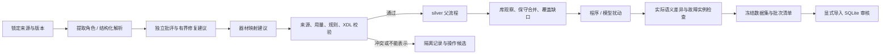

# MOSAIC：当前重构目标

MOSAIC = **Multi-agent Orchestration for Source-grounded Actions, Instruments and Constraints**。
工作分支：`refactor/mosaic`，从 `main` 的 `7a960ed` 继承。

本轮目标由用户于 2026-10-26 明确提出：重构提取、器材映射和扰动代码，形成有设计、代码整洁、可扩展的多智能体系统；用它生成来源可靠、故障机制和扰动方式更丰富的新样例，最终在现有审计网页中实际展示和审核。旧派生数据已有远程存档，无需为兼容旧数据限制新设计。

## 验收标准

- 从真实来源到可审核正负记录可实际运行；保存来源版本、原文定位、阶段产物和验证结果。
- 智能体有明确职责和输入输出；区分真实模型调用、程序处理与缓存重放，不把普通函数改名当成已完成多智能体提取。
- 提取保留缺失、冲突、未映射动作；批评智能体提出问题和修复建议，程序检查决定是否接受修改。
- 领域以可替换的配置和实现扩展；支持范围之外的操作必须显式保留或隔离，不扁平化成已有动作。
- 器材映射保留来源类型、容量和容量范围；来源事实、建议配置、厂商额定参数与人工验证分别表示。
- 自动器材/操作库维护支持有据新增和无损合并、别名与版本追踪；不能为凑最小集删掉独立物理作用、风险信息或未覆盖操作。
- 扰动智能体负责寻找前置条件与故障机制；明确的变换由程序执行，模型提出的变换也必须通过可重放和针对性检查。
- 多样性统计包含父来源、流程结构、器材、被修改操作与故障机制；只改数值或化学品名字不能冒充机制丰富。
- 生成的 hard 例需父流程检查通过、子流程仅命中目标风险；单风险类别还不足以独立证明单故障，必须额外约束允许的语义修改。
- soft 例标明未观察结果和未校准状态；未完成独立核验的记录不得自动成为严格 gold。
- 新样例实际导入 SQLite，审计网页可翻页、定位扰动、显示原因、提交真实决定和带时间戳导出；不重新建立 JSON/数据库同步。
- 测试覆盖完整提取运行、器材未知/冲突、库演化、扰动重放与多样性、审核导入展示；提供一条可复现命令与真实运行报告。

原任务的数据量级仍作为首批交付参照：100+ 真实来源正例和 raw，20 个风险子类各 10+ 候选。数量不足或独立机制不足时必须统计缺口，不靠控制场景或重复编号填补真实来源数量。

## 设计约束

1. 先提供一个能贯穿真实数据的深 module，再逐步扩展；不为假想后端增加框架、消息队列或泛化层级。
2. 模型调用沿用 `.env` 的 `api_key`、`base_url`、`model`。默认已探测 `gpt-5.6-terra`；允许按角色配置其他端点支持的模型，实际返回与成本需留记录。
3. 运行、检查、统计和审核导入必须引用同一份版本清单，避免生成 v2 却检查默认旧目录。
4. 提取产物与来源、库版本相绑定；可缓存重放。失败保留结构化原因，不能用无依据补全换取通过。
5. 现有审计应用保持 Streamlit + pandas + sqlite3；不因提取端重构增加其依赖。
6. 官方平台编译兼容性暂放。导出、静态约束通过和真实实验执行是不同证据。

## 当前进展

- [x] 创建重构分支，安装 mattpocock 正式发布的工程与生产力技能。
- [x] 核查 ACRA 正式论文与固定版本公开代码；研究记录见 `research/acra.md`。
- [x] 重新验证默认 API：真实请求 HTTP 200，随机 nonce JSON 正确，无效密钥 HTTP 401。
- [x] 发现端点提供包括 `gpt-6.1-sol` 在内的模型 ID；这不构成模型效果评测。
- [x] 比较三种编排／领域设计，公共入口为 `build(spec, runtime)`、`resume(run_dir)`。
- [x] 实现真实模型角色、来源定位和有界修复；错误建议独立拒绝，原文尺度冲突隔离。
- [x] 实现库版本、候选与观察、相同契约别名和有证据的覆盖求解；不宣称通用最小集。
- [x] 重构程序／模型扰动、单次语义修改约束、故障实例归并及机制优先选择。
- [x] 批量生成完成：140 ORD 父流程，补充 26 条父记录，20 类各 10 条负例，44 个扰动分组；来源／补丁验收通过。
- [x] 366 条记录实际导入 SQLite；浏览器实测翻页、风险原因、A5／D2 定位、帮助和移动端通过。
- [x] 复现命令与范围已写入 README；禁止 HTTP 的 372 文件重放逐字节一致，主测试 266 通过、审计测试 40 通过。

首批结果与仍同质的类别见 [质量报告](../reports/mosaic_quality.md)。最小操作集与额定器材覆盖仍以证据逐步收敛，未宣称已证明通用最小集。

线程 Goal 工具仍持有旧目标，当前状态为 `usageLimited`；创建新目标请求被工具拒绝。旧目标未被虚标完成。本文件记录本轮用户要求的目标和进展，不冒充工具已成功创建新 Goal。

## 实际编排

文字来源默认最多并发四条（`--workers 1..16`）；相同请求只执行一次，共享调用预算和受锁保护的阶段写入。来源结果按固定顺序收集，再做配额与机制选择。单个批次目录使用一个构建进程；自定义领域若有可变状态，可设置 `workers=1`。

核心只要求领域提供来源判定、提取、校验、扰动、库及补充来源；测试中的第二领域不需要化学字段。当前规模主要需要可验证阶段、缓存和受控调用，因此使用轻量 Python 编排。ACRA、LangGraph 等项目提供设计参考，没有整体引入其依赖。

## 清理边界

移除旧全局构建器、旧批量提取器、旧扰动筛选编排、独立 SOP／原生负例入口和旧统计／重建代码。化学校验移至 `protocol_risk/validation.py`，机制规则移至 `mutation_rules.py`，手写控制移至测试夹具。保留来源获取、原始来源和锁文件；旧派生数据与失效报告按具体 Git 文件清单删除，没有改写历史或删除 `.env`。
