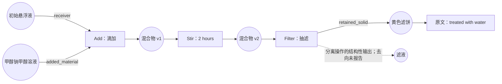

# Pipeline 梳理层：物料状态与操作图

状态：设计草案，待讨论；不改变冻结运行 `2b5ca0d` 的代码、提示、库或产物。

## 目标

从原始实验文字识别物料、状态、操作、条件和依赖，再由程序编译为扩展 XDL。图必须区分“向悬浮液加入某物”与“把悬浮液加入某处”，并能追踪 mixture、solution、residue、filtrate 等跨句引用。

建议让现有 extractor 承担 Pipeline 梳理职责，一次生成事实与图；不先自由改写一遍步骤文字再交给另一个提取器。原文始终是共同输入。事实、证据和图使用同一套稳定 ID，不维护两份互相矛盾的材料与用量表。

## 图的合同

物料流部分是有向双部图：`物料状态 → 操作 → 新物料状态`。节点与边描述以下信息：

| 对象 | 最小内容 | 例子 |
|---|---|---|
| MaterialState | 稳定 ID、物料身份／组成事实引用、已报告形态、来源类别、证据 | 加料前的悬浮液、搅拌后的混合物、滤饼 |
| Operation | 稳定 ID、原文操作表达、带角色的输入、输出状态、参数事实引用、证据 | Add 的加入物与接收物；Filter 的滤饼与滤液 |
| Material flow | 状态、操作、角色、证据／派生依据 | added_material、receiver、retained_solid、filtrate |
| Temporal constraint | 两个操作、关系、证据 | precedes、same_interval、during；未报告的顺序不补齐 |
| Equipment use | 操作、设备／逻辑位置引用、角色、状态 | 作用设备、容器、来源、去向；未知设备不创建型号或子型 |
| Fact | 原文字面、语义值、单位、状态、主体与范围、证据 | 25.4 g 属于悬浮液组分，18 ml 属于加入份额 |

节点 ID 区分身份与状态：同一物料经加料、过滤等操作后使用新的 state ID，并保存 lineage；不会反复覆盖一个名叫 mixture 的对象。状态版本只描述流程来源，不推断反应后化学组成或数量。

时序、并发和设备关系单独存放，不把所有边都当成先后关系。物料流的一个实例通常为 DAG；明确的重复或条件循环使用有边界的控制块，其 body 可为 DAG。未报告次数／停止条件保留未知；不把任意循环强行展开，也不把所有步骤串行化。

## 三种证据来源必须区分

1. `reported_action`：原文明确写出的实验动作。
2. `reported_initial_state`：原文描述已经存在的混合物及组成，没有写出制备动作。
3. `compiler_derived_initialization`：为满足某个目标平台的输入要求，由确定性规则生成的初始化步骤。它不是原文动作，也不是 agent 猜测的实验事实。

规则只允许从明确的组成关系生成必要的配置／加入指令。规则不得推断溶解、搅拌、加热、加料顺序、设备规格、混合后总体积或 15% 的质量／体积基准。生成的步骤保留 `derived_from` 事实引用与编译策略版本，写于配套 JSON，不通过扩展 XML 属性混入 provenance。

## 当前失败样例应如何表达

`ord-8841b6b409c7485da9c83fc3053ea8a7` 的来源文本表明：甲醇钠甲醇溶液被滴加到已有悬浮液中，随后搅拌两小时、抽滤，保留的黄色沉淀经水处理后再抽滤。



滤液节点可以表示分离操作语义所要求的潜在输出，其来源标记为 `operation_semantics`；不得宣称原文报告了收集、体积、组成或去向。滤饼继续参与后续动作由原文黄色沉淀的共指支持。水处理具体机制仍待语义确认，不能自动替换成 WashSolid、溶解或重新悬浮。

为便于阅读，下面省略原文证据表、实体表和部分事实，并用 A、B 替代完整化合物名称。它是建议合同的示意，不是当前程序已经生成的输出：

```json
{
  "states": [
    {
      "id": "suspension_0",
      "form": "suspension",
      "origin": "reported_initial_state",
      "components": [
        {"material": "A", "quantity": "25.4 g"},
        {"material": "B", "quantity": "11.3 g"},
        {"material": "ethanol", "quantity": "150 ml"}
      ],
      "preparation": {"status": "not_reported", "addition_order": "not_reported"}
    },
    {"id": "methylate_solution_0", "origin": "reported_initial_state"},
    {"id": "mixture_1", "origin": "event_output", "produced_by": "add_1"}
  ],
  "operations": [
    {
      "id": "add_1",
      "expression": "add",
      "origin": "reported_action",
      "roles": {
        "added_material": "methylate_solution_0",
        "receiver": "suspension_0"
      },
      "parameters": {"volume": "18 ml", "method": "dropwise"},
      "outputs": {"result": "mixture_1"}
    }
  ]
}
```

生产合同使用既有 Fact ID 引用代替上述内嵌 quantity 字符串；每个成分、数量、角色、动作及共指连接必须能定位原文或确定性语义规则。浓度为已报告的 15%，但基准未报告；室温为定性条件；容器未报告。

## 对 XDL 编译的约束

默认的保真表示保留初始状态作为前置条件；原文动作从向其加入溶液开始。是否将初始状态物化为 XDL 的初始化步骤，是显式编译配置，而不是提取器自行决定的实验事实。

启用初始化时，可由已报告组成产生加入 A、B 和乙醇的计划；它们构成“全部先于溶液滴加”的依赖组，不声称三者的顺序。若所选 XDL／平台必须给出线性顺序，程序不能随机选择并宣称与原文等价：需要平台批准的确定性策略及派生记录，或保留为未解决的执行条件。

保真数据中可以保留未知值，但不能因此宣称已具备可执行性。未给出的接收容器类型、位置与额定参数不可由编译器补造。目标 XDL 不能容纳的初始状态或并发结构应明确报告表达限制；不能用任意 XML 属性伪装支持。

XDL 仍保留既有 XML 结构；只使用已登记操作／器材及其参数合同。图、规范 ID、证据、组成、派生计划和范围信息保留于配套 JSON。禁止 `subject_<entity_id>_mass` 等随样例变化的属性；当前编译器的自动兜底扩展应在下一实现轮次替换为明确合同。

官方 XDL 文档已经提供可选的 `Prep`、`Reaction`、`Workup`、`Purification` 分区，因此经批准的初始化指令可以放入既有 `Prep`，无需发明图形 XML 语法。但这些分区本身不能证明初始化来自原文，也不表达“未知加料顺序”。官方 Add 的 `reagent` 是加入物，`vessel` 是目标容器；receiver 状态到容器的定位应由图与设备绑定解析，不能再把 receiver 作为第二个 reagent。[文件结构](https://croningroup.gitlab.io/chemputer/xdl/standard/xdl_file_structure.html)、[步骤合同](https://croningroup.gitlab.io/chemputer/xdl/standard/full_steps_specification.html)

## Agent 与程序职责

| 角色 | 应做 | 不应做 |
|---|---|---|
| Pipeline 梳理 agent | 读全文；提出状态、操作、角色、范围、共指、分支与证据 | 为使步骤完整而发明原文未给的制备条件 |
| 图校验程序 | 检查引用、类型、角色合同、状态 lineage、用量归属、覆盖与时序一致性 | 以合法 JSON／无环来证明科学正确 |
| 独立核对 agent | 原文对照图，检查遗漏／猜测、初始状态误写动作、输入接收物反转、滤饼滤液接错等 | 仅检查 planner 的文字摘要，或自由重写整图 |
| 库维护 agent | 为新操作／器材提出语义及映射；动作包含角色、前置条件及状态效果 | 根据名称相似合并新语义，或改写原文事实 |
| 编译器和独立检查器 | 按合同输出 XDL，再独立读取 XML 对照图和事实 | 依赖任意动态属性弥补角色缺失 |

建议正常流程保持两次模型调用：梳理／提取一次，独立核对一次；格式与语义修复共一次预算。库维护仍按整批处理。可在同一次梳理调用中分配事实抽取与关系规划的输出区，不默认新增一轮文字改写调用。

## 下一实现轮次的最小验证

先用已保存模型回执和人工确认的小图验证通用语义，不再为本批追加提取调用：

- `add A to B` 与 `add B to A`：只改变加入物与接收物；数量不串绑。
- 现成 suspension 与明确 `prepare ... by ...`：仅后一种具有来源动作。
- 初始混合物、跨句 mixture／solution、混合后状态：ID 可追踪且不重复加料。
- 过滤后处理 residue 与 filtrate：后续支路分别连接，不混为同一个样品。
- `heat while stirring`、并行制备 A/B、重复洗涤：保持并发／依赖／次数合同。
- equipment 被 purged／cleaned：作为动作的作用对象，不塞进物料 participant。
- 分数时长、带度符号的区间、`4-M` 浓度：保留原文字面与可验证语义值。
- microreactor：保留标准子型，不凭名称推断连续流。
- 未知原子操作：能够经角色、前置条件、状态效果的库演化进入系统。

评价至少分别报告实体／数量覆盖、角色与共指正确率、物料流边及时间关系正确率、无依据新增动作、图到 XML 的保留率、专家确认程度。图看起来合理和 XML 能解析均不足以通过验收。

实施顺序为：确认图合同 → 替换现有平铺 participant 及动态属性兜底 → 离线证据验收 → 冻结新版本 → 一次整批真实验证。每批结束再讨论缺陷，不逐样例修改代码。

## 参考

PEG 将生物实验 protocol 表示为文档级过程图，处理跨句共指、隐含参数，并在标注时追踪实体属性；MSTG 研究跨动作的物料状态及跨句依赖。这些支持选择物料／操作关系作为表示设计，但不能证明本项目已经实现或达到其性能。

- [Process-Level Representation of Scientific Protocols with Interactive Annotation](https://arxiv.org/abs/2101.10244)
- [Learning Latent Structures for Cross Action Phrase Relations in Wet Lab Protocols](https://aclanthology.org/2021.acl-long.525/)

其余一手资料与适用范围见 [梳理层调研](research/WORKFLOW_STATE_PLANNING.md)。以上合同及实施方案为 MOSAIC 的设计建议。
