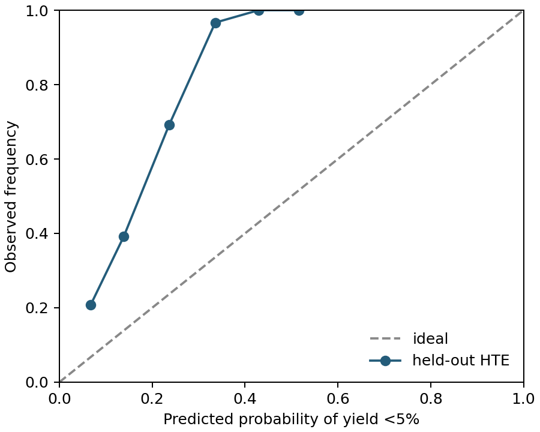

# Judge 准入报告

当前模型未准入，不能作为 Jev-as-judge。

HTE 真实观测 11,897 条，其中 <5% 低产率 3,146 条；按 17 个产物骨架分组。
划分：{'train': 4372, 'val': 5346, 'test': 2179}；骨架交叉泄漏：False。验证集单独做 Platt 校准。

通用低产率基线测试：AUROC=0.7242；ECE=0.2391；p≥0.9 数量=0；precision=None。
这些是通用低产率预测指标，不能当作 C 子类指标。

| 子类 | 是否准入 | 原因 |
|---|---|---|
| C1 | 否 | 缺少该子类的因果归因与独立校准标签 |
| C2 | 否 | 缺少该子类的因果归因与独立校准标签 |
| C3 | 否 | 缺少该子类的因果归因与独立校准标签 |
| C4 | 否 | 缺少该子类的因果归因与独立校准标签 |
| C6 | 否 | 缺少该子类的因果归因与独立校准标签 |

## 测试中误差最大的 20 条

| ORD ID | 实测产率 % | 预测低产率概率 |
|---|---:|---:|
| ord-05ee928742244cfb88781b278209f0a4 | 3.500 | 0.0288 |
| ord-5aa0303b5a6a476e8cd43e8765eb5b3f | 1.414 | 0.0289 |
| ord-041ae889a96143b584b713448a304e14 | 1.728 | 0.0306 |
| ord-17c728edb8c347c7bdd0c5136c3e822e | 3.524 | 0.0306 |
| ord-331bf46e18bb41348e4dd8586b33b265 | 1.858 | 0.0306 |
| ord-69677116cb574edab35b3a3e2d99362c | 4.582 | 0.0313 |
| ord-b067b2caf731448e96bb116673767b2b | 1.186 | 0.0313 |
| ord-1a0037abf91d42d181705e5b1887b235 | 1.153 | 0.0352 |
| ord-b8ca51dba4da43a7a374cd77c137f424 | 3.864 | 0.0352 |
| ord-4e8919903fee4d13b7616746c2a68e43 | 1.443 | 0.0426 |
| ord-72a1f737b1b7471490f831c11c17dd19 | 0.400 | 0.0426 |
| ord-34bfb2464e8548a989fb30a371c87209 | 2.942 | 0.0429 |
| ord-fde3278cbef846899f443f86b2a7b57a | 1.508 | 0.0448 |
| ord-949794d897ee49e998398f6fb1351964 | 1.403 | 0.0452 |
| ord-95b22b31bbc24b249e0bd7d109299b3d | 0.530 | 0.0453 |
| ord-862b5316e03948ef8f799f00cf0073e1 | 4.452 | 0.0455 |
| ord-d5fd842ee0a04a7b832d6e1e6cd593fe | 0.963 | 0.0455 |
| ord-361bf9a799f14980b491b171a8109acc | 0.382 | 0.0459 |
| ord-5b72920b285f4fe38fe00af0b7edf8b9 | 0.745 | 0.0459 |
| ord-48c51b1fbf364c4c90d8a646e823dbc6 | 0.647 | 0.0460 |
