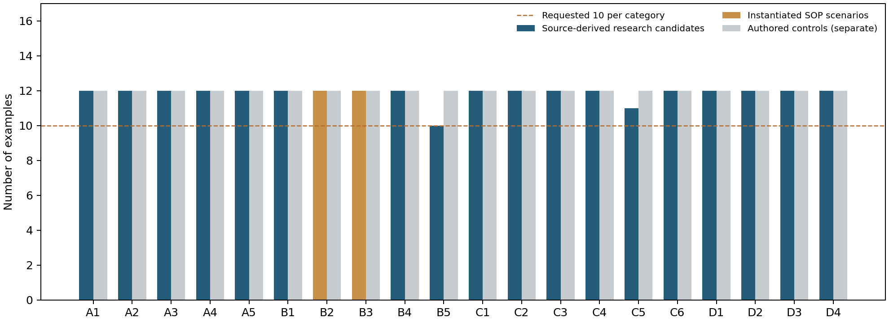

# 数据集统计

本报告由实际产物自动生成。

- 固定来源：46 个 ORD 数据文件，41,174 条真实 raw 反应。
- 选中 raw / XDL：140 / 140。
- 提取方式：文本 20；结构化反应阶段 120。
- 全部初始用量通过独立原文数值核对：2 条；其余仍待补证。
- 去重后独立流程 140；反应 SMILES 89；选中数据集 11。
- 严格 gold：0；silver：140。
- 研究候选负例合计：237，各类至少 10 条；直接来源派生 213，来源约束下的生成场景 24。
- 直接来源分区：ORD 191；作者原生 XDL 12；原文 SOP 片段 10。
- 独立手写控制负例：240，不算作真实 ORD 派生 gold。
- 器材 21 条，人工 verified 0 条；原子操作 12；风险子类 20。
- 假负样本过滤检查固定来源中的 12,619 条 ≥30% 成功观测。
- 内部完整性审计：通过；完整规范验收：尚未通过。

| 风险 | 类别 | ORD 派生 | 原生 XDL | SOP 原文片段 | SOP 生成场景 | 候选合计 | 手写控制 | 距 10 条缺口 |
|---|---|---:|---:|---:|---:|---:|---:|---:|
| A1 | 容量或装填率越界 | 12 | 0 | 0 | 0 | 12 | 12 | 0 |
| A2 | 温控越界 | 12 | 0 | 0 | 0 | 12 | 12 | 0 |
| A3 | 转速或流速越界 | 12 | 0 | 0 | 0 | 12 | 12 | 0 |
| A4 | 材质不兼容 | 12 | 0 | 0 | 0 | 12 | 12 | 0 |
| A5 | 硬件拓扑缺件 | 12 | 0 | 0 | 0 | 12 | 12 | 0 |
| B1 | 开放体系超沸点 | 12 | 0 | 0 | 0 | 12 | 12 | 0 |
| B2 | 低于凝固点 | 0 | 0 | 0 | 12 | 12 | 12 | 0 |
| B3 | 点火或自燃边界 | 0 | 0 | 0 | 12 | 12 | 12 | 0 |
| B4 | 不相容试剂对 | 12 | 0 | 0 | 0 | 12 | 12 | 0 |
| B5 | 加料顺序放热 | 0 | 0 | 10 | 0 | 10 | 12 | 0 |
| C1 | 溶剂条件扰动 | 12 | 0 | 0 | 0 | 12 | 12 | 0 |
| C2 | 温度条件扰动 | 12 | 0 | 0 | 0 | 12 | 12 | 0 |
| C3 | 试剂或催化剂扰动 | 12 | 0 | 0 | 0 | 12 | 12 | 0 |
| C4 | 计量条件扰动 | 12 | 0 | 0 | 0 | 12 | 12 | 0 |
| C5 | 敏感体系气氛缺失 | 11 | 0 | 0 | 0 | 11 | 12 | 0 |
| C6 | 时间条件扰动 | 12 | 0 | 0 | 0 | 12 | 12 | 0 |
| D1 | 步骤依赖顺序错误 | 12 | 0 | 0 | 0 | 12 | 12 | 0 |
| D2 | 关键步骤缺失 | 0 | 12 | 0 | 0 | 12 | 12 | 0 |
| D3 | 引用未声明 | 12 | 0 | 0 | 0 | 12 | 12 | 0 |
| D4 | 单位维度错误 | 12 | 0 | 0 | 0 | 12 | 12 | 0 |

C1/C2/C3/C4/C6 是未校准的条件扰动，不能把这五类的候选数量解读为已证实的失败数量。
所有 silver 父流程仍需独立核对主要用量、完整流程和器材；研究候选 benchmark_eligible=false。
当前按用户要求优先构造数据。带厂商出处并已核对的参数可以支持临时研究约束，明确标记 source_reviewed_provisional；人工审核暂缓，verified 不会自动置 true。
作者原生 D2 删除向初始空容器输送物料的唯一语句，保留后续蒸发，错误依据是明确的物料输入缺失；其检查范围与 ORD IR 检查分开记录。

B5 使用 10 组数值不同的原文稀释片段。B2 有 1 个 DMSO 解冻父场景、12 个温度变体；B3 有 6 种溶剂、2 类点火源的 12 个场景。B2/B3 的 30 C 等设定值是明确标注的实例参数，不是原文实验值，也不计入直接来源样例配额。
SOP 仅表达已解析片段；缓慢加料、冷却和定容等未量化指令保留为 unresolved_instructions。B3 点火和预装物料属于侧车上下文；单独 XDL 不证明全部设备行为。

原子操作统计见 [atomic_operations.md](atomic_operations.md)。

人工复核队列在 manual_review.csv；尚未填写的记录不算作人工通过。

原配套平台检查：101 份作者原生程序中，89 份通过类型解析，64 份在原图上通过编译与内置检查。
通过程序的作者分区：{'successful_reactions': 41, 'translated_XDLs': 23}；编译参考数据与 ORD 的 140 组候选分别保存，不累计冒充完整 gold。
详细结果见 [native_platform.md](native_platform.md)。原始编译器源码未改动；格式别名、外层 XML 包装与缺省异步进程 ID 的适配均有记录。
